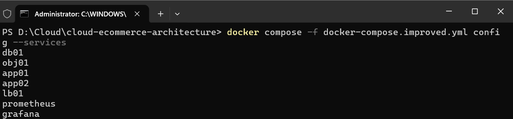
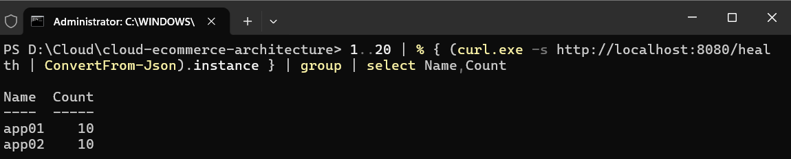
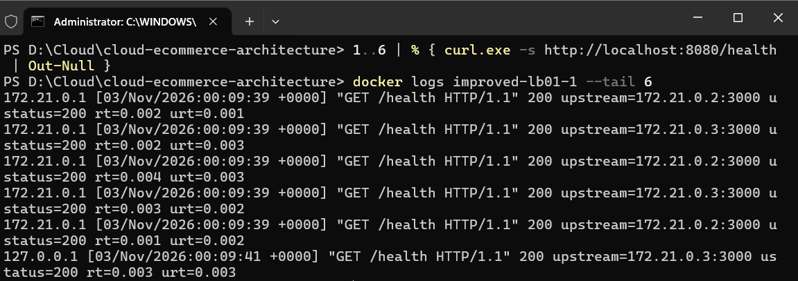
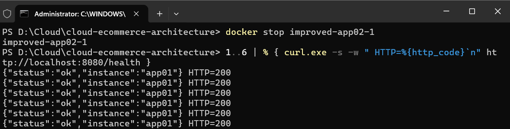
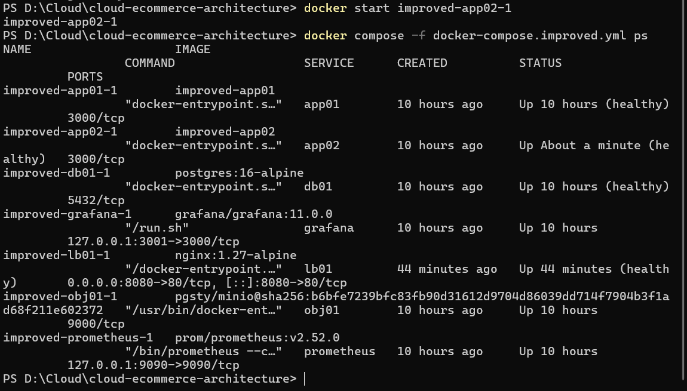

# Bằng chứng triển khai từ 2 bản sao ứng dụng (APP01, APP02)

- Người thực hiện: Lê Văn Nhựt
- Phạm vi: dòng 11 – triển khai ít nhất 2 bản sao ứng dụng phía sau `lb01`
- Môi trường: Docker Compose, file `docker-compose.improved.yml`
- Ngày kiểm thử: 03/11/2026

## 1. Cấu hình

Hai bản sao là hai service riêng `app01` và `app02`, dùng chung một mã nguồn (`build: ./app`) và chung khối biến môi trường `&appenv`. Chỉ có `INSTANCE` khác nhau để phân biệt trong phản hồi.

```yaml
  app01:
    build: ./app
    environment: &appenv
      INSTANCE: app01
      ...
    networks: [frontend, backend, monitoring]
    mem_limit: 512m
    cpus: "0.5"
    restart: unless-stopped
    healthcheck: &apphc
      test: ["CMD-SHELL", "wget -qO- http://127.0.0.1:3000/health || exit 1"]
  app02:
    build: ./app
    environment: { <<: *appenv, INSTANCE: app02 }
    networks: [frontend, backend, monitoring]
    healthcheck: *apphc
```

| Thuộc tính | app01 | app02 |
|---|---|---|
| Image build | `./app` | `./app` |
| `INSTANCE` | `app01` | `app02` |
| Mạng | frontend, backend, monitoring | frontend, backend, monitoring |
| Giới hạn | 512m RAM, 0.5 CPU | 512m RAM, 0.5 CPU |
| Healthcheck | `/health` mỗi 10s | `/health` mỗi 10s (dùng chung `&apphc`) |
| Khởi động | sau `db01` healthy | sau `db01` healthy |
| Phía trước | `lb01` (upstream `app01:3000`) | `lb01` (upstream `app02:3000`) |

## 2. Hai bản sao là hai service độc lập

Lệnh `docker compose config --services` liệt kê cả `app01` và `app02`:



## 3. Cả hai bản sao đều nhận request

Ứng dụng không ghi log từng request, nên bằng chứng lấy từ hai nguồn đã thu thập ở dòng 10:

- Trường `instance` trong phản hồi `/health`: 20 request chia 10/10 giữa `app01` và `app02`.



- Log `lb01` ghi `upstream=` luân phiên hai địa chỉ nội bộ khác nhau, `ustatus=200`.



## 4. Kịch bản lỗi: dừng một bản sao

Dừng `app02` (`docker stop improved-app02-1`), gửi 6 request: cả 6 đều do `app01` trả lời, `HTTP=200`, không có lỗi 502.



Bật lại `app02` (`docker start improved-app02-1`): sau khoảng 1 phút `app02` trở lại `(healthy)`, `lb01` vẫn `(healthy)` suốt quá trình.



## 5. Kết luận theo yêu cầu dòng 11

| Yêu cầu | Kết quả |
|---|---|
| Triển khai ít nhất 2 bản sao ứng dụng (APP01, APP02) | Đạt, hai service `app01`, `app02` cùng `healthy` |
| Cấu hình replicas | Đạt, hai service dùng chung image và khối môi trường |
| Log cả hai bản sao nhận request | Đạt, qua trường `instance` (10/10) và log `upstream=` của `lb01` |
| Một bản sao dừng thì hệ thống vẫn phục vụ | Đạt, dừng `app02` vẫn `HTTP=200` |

## 6. Hạn chế

- Cả hai bản sao chạy trên cùng một máy chủ Docker, nên chưa chịu được lỗi mức máy chủ; chỉ chịu được lỗi mức tiến trình hoặc container.
- Nhân bản bằng cách khai báo hai service riêng, chưa dùng `deploy.replicas` hay Kubernetes, và chưa có tự động mở rộng.
- Hai bản sao dùng chung một `db01` và một `obj01`, hai thành phần này vẫn là điểm lỗi đơn.
