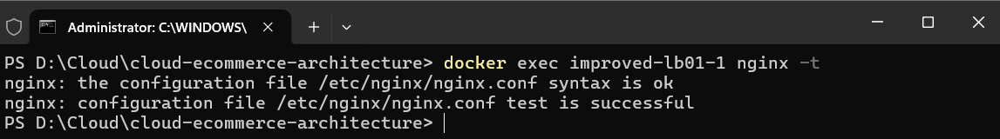
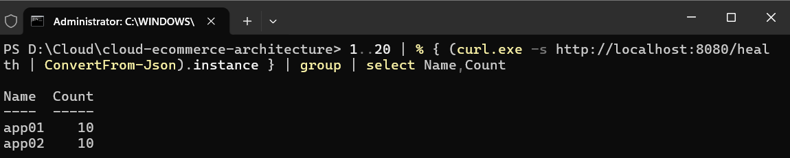
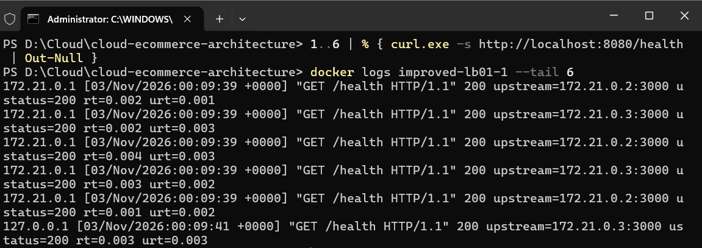
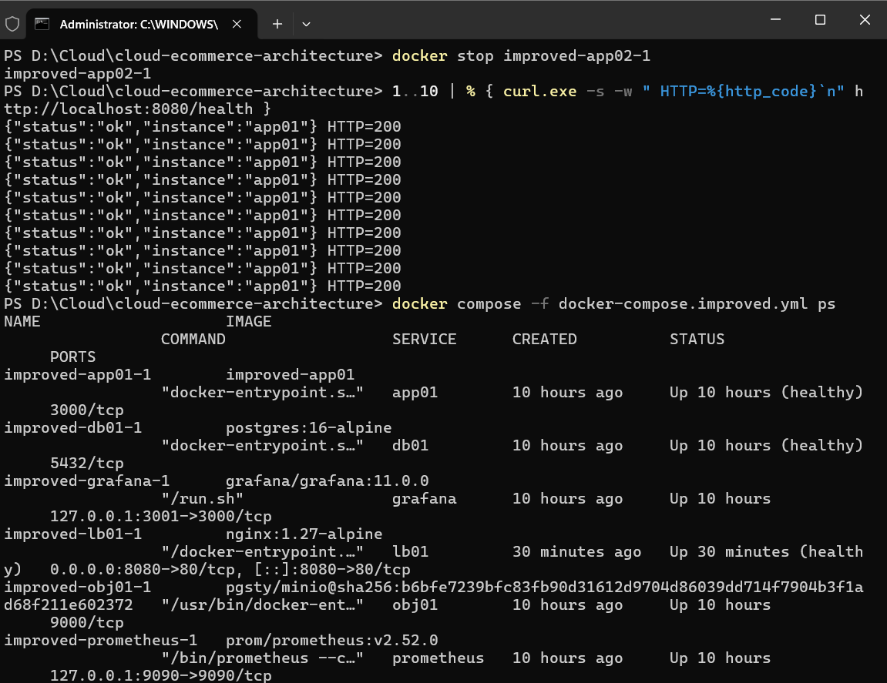
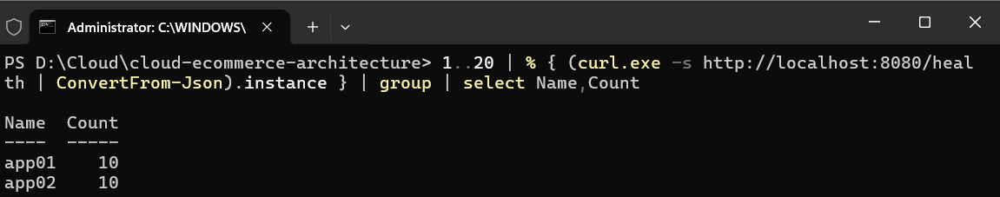

# Bằng chứng cấu hình Load Balancer (LB01)

- Người thực hiện: Lê Văn Nhựt
- Phạm vi: dòng 10 – Load balancer (Nginx) kèm health check và cơ chế loại bản sao lỗi
- Môi trường: Docker Compose, file `docker-compose.improved.yml`
- Ngày kiểm thử: 03/11/2026

## 1. Cấu hình

`lb01` dùng `nginx:1.27-alpine`, chỉ nằm ở mạng `frontend`, cổng `8080:80`.

| Thành phần | Giá trị |
|---|---|
| Upstream `app_pool` | `app01:3000`, `app02:3000` (round-robin mặc định) |
| Loại bản sao lỗi | `max_fails=2`, `fail_timeout=5s` |
| Chuyển sang bản sao khác | `proxy_next_upstream error timeout http_502 http_503` |
| Timeout kết nối / đọc | `proxy_connect_timeout 1s`, `proxy_read_timeout 10s` |
| Header chuyển tiếp | `Host`, `X-Real-IP`, `X-Forwarded-For` |
| Log | `log_format lb` có `$upstream_addr`, `$upstream_status`, `$request_time` |
| Healthcheck container | `wget -qO- http://127.0.0.1:80/health` (10s/lần, retries 5) |
| `depends_on` | chỉ khởi động khi `app01`, `app02` đều `healthy` |

File cấu hình: `nginx/nginx.conf`. Phần log và header là bổ sung của dòng 10; upstream và các tham số `max_fails`, `fail_timeout`, `proxy_next_upstream`, `proxy_connect_timeout` giữ nguyên từ bản gốc.

## 2. Kiểm tra cú pháp

```
docker exec improved-lb01-1 nginx -t
nginx: the configuration file /etc/nginx/nginx.conf syntax is ok
nginx: configuration file /etc/nginx/nginx.conf test is successful
```



## 3. Bằng chứng phân phối tải

Gửi 20 request đến `http://localhost:8080/health`, đếm theo `instance`:

| Instance | Số request |
|---|---|
| app01 | 10 |
| app02 | 10 |

Kết luận: tải được chia đều giữa hai bản sao (round-robin).



Log của `lb01` sau khi bật `log_format lb` cho thấy request luân phiên giữa hai địa chỉ upstream, `ustatus=200`:

```
172.21.0.1 [03/Nov/2026:00:09:39 +0000] "GET /health HTTP/1.1" 200 upstream=172.21.0.2:3000 ustatus=200 rt=0.002 urt=0.001
172.21.0.1 [03/Nov/2026:00:09:39 +0000] "GET /health HTTP/1.1" 200 upstream=172.21.0.3:3000 ustatus=200 rt=0.002 urt=0.003
172.21.0.1 [03/Nov/2026:00:09:39 +0000] "GET /health HTTP/1.1" 200 upstream=172.21.0.2:3000 ustatus=200 rt=0.004 urt=0.003
172.21.0.1 [03/Nov/2026:00:09:39 +0000] "GET /health HTTP/1.1" 200 upstream=172.21.0.3:3000 ustatus=200 rt=0.003 urt=0.002
```



## 4. Bằng chứng loại bản sao lỗi

Dừng `app02` (`docker stop improved-app02-1`) rồi gửi 10 request:

- Cả 10 request trả về `instance: app01`, `HTTP=200`, không có lỗi 502.
- `docker compose ps` không còn `app02`; `lb01` vẫn `healthy`.

Log `lb01` ghi nhận khi `app02` mất kết nối, Nginx báo `upstream timed out (110) while connecting to upstream` tới địa chỉ của `app02`, sau đó vẫn trả `200` cho client nhờ `proxy_next_upstream`.



## 5. Bằng chứng bản sao phục hồi

Bật lại `app02` (`docker start improved-app02-1`), chờ `healthy`, gửi 20 request:

| Instance | Số request |
|---|---|
| app01 | 10 |
| app02 | 10 |

Kết luận: `app02` nhận tải trở lại mà không cần reload `lb01`.



## 6. Kết luận theo yêu cầu dòng 10

| Yêu cầu | Kết quả |
|---|---|
| Load balancer (Nginx) | Đạt, `lb01` chạy `healthy` |
| Health check | Đạt, healthcheck cho `lb01`, `app01`, `app02` |
| Cơ chế loại bản sao lỗi | Đạt, dừng `app02` vẫn `HTTP=200` |
| Bằng chứng phân phối lưu lượng | Đạt, đếm 10/10, log có `upstream=` |

## 7. Hạn chế

- Nginx bản mã nguồn mở chỉ có kiểm tra **bị động** (`max_fails`), không chủ động thăm dò sức khỏe từng bản sao.
- Nginx phân giải tên `app01`, `app02` lúc khởi động hoặc reload. Nếu một bản sao đang dừng đúng lúc `lb01` khởi động hoặc reload, Nginx báo `host not found in upstream` và cấu hình không nạp được. Cần bật đủ bản sao trước khi reload `lb01`.
- `lb01` là điểm lỗi đơn (SPOF) trong phạm vi đồ án này; chưa có LB dự phòng.
- Round-robin mặc định chưa tính đến tải thực tế của từng bản sao.
