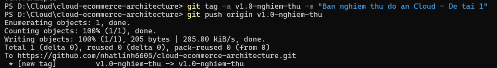
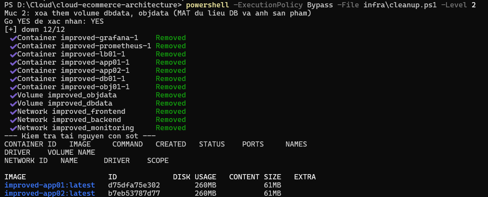

# Xác nhận nghiệm thu: thẻ phiên bản và dọn tài nguyên

- Người thực hiện: Lê Văn Nhựt
- Phạm vi: dòng 16 – rà soát hạ tầng, gắn thẻ phiên bản nghiệm thu, xác nhận dọn tài nguyên
- Ngày thực hiện: 11/11/2026

## 1. Thẻ phiên bản nghiệm thu

Thẻ `v1.0-nghiem-thu` được gắn tại commit hiện tại của nhánh `main` và đã đẩy lên kho `nhatlinh6605/cloud-ecommerce-architecture`.

```
git tag -a v1.0-nghiem-thu -m "Ban nghiem thu do an Cloud - De tai 1"
git push origin v1.0-nghiem-thu
 * [new tag]         v1.0-nghiem-thu -> v1.0-nghiem-thu
```



Có thể dựng lại đúng phiên bản nghiệm thu bằng `git checkout v1.0-nghiem-thu`.

## 2. Dọn tài nguyên

Chạy script `infra/cleanup.ps1` ở mức 2 (xóa container, mạng và volume dữ liệu), có xác nhận trước khi xóa.

```
powershell -ExecutionPolicy Bypass -File infra\cleanup.ps1 -Level 2
```

Kết quả:

| Loại tài nguyên | Đã xóa |
|---|---|
| Container (7) | `improved-grafana-1`, `improved-prometheus-1`, `improved-lb01-1`, `improved-app01-1`, `improved-app02-1`, `improved-db01-1`, `improved-obj01-1` |
| Volume (2) | `improved_objdata`, `improved_dbdata` |
| Mạng (3) | `improved_frontend`, `improved_backend`, `improved_monitoring` |

Bước kiểm tra tài nguyên còn sót của script cho thấy không còn container, volume hay mạng nào có tiền tố `improved`. Chỉ còn hai image build cục bộ `improved-app01:latest` và `improved-app02:latest`, đúng thiết kế của mức 2 (image chỉ bị xóa ở mức 3).



## 3. Tài nguyên có phí

Toàn bộ đồ án chạy cục bộ bằng Docker Compose trên máy cá nhân, không tạo tài nguyên nào trên nền tảng cloud. Các con số chi phí trong báo cáo (mục 4.5) là ước tính theo bảng giá, không phát sinh chi phí thực tế.
